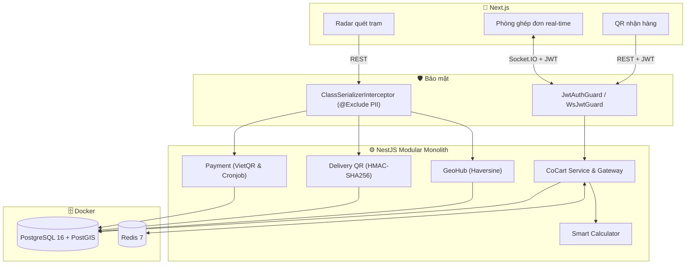

# 🛒 Co-Cart — Giỏ Hàng Ghép Bảo Vệ Riêng Tư & Tối Ưu Vận Chuyển Xanh


> **Co-Cart** cho phép sinh viên nội trú, cư dân chung cư và nhân viên văn phòng **ghép chung giỏ hàng đóng gói (đồ uống, snack, văn phòng phẩm...) theo thời gian thực**: một người tạo giỏ, bạn bè cùng điểm nhận hàng vào bằng mã và chỉ thấy biệt danh của nhau. Hệ thống tự cộng đơn, chia phí ship minh bạch và cấp QR nhận hàng riêng.

> ⚠️ Các mức "tiết kiệm 50–80% phí ship" và "giảm 40–60% chuyến giao" trong đề án là **giả thuyết cần kiểm chứng** qua khảo sát và pilot, không phải kết quả đã đo. Ứng dụng chỉ hiển thị số liệu tính trực tiếp từ giỏ (phí ship so với đặt lẻ, số chuyến giảm); CO₂ là **ước tính theo giả định** `CO2_GRAMS_PER_TRIP`.

## 📋 Phạm vi MVP (theo đề án)

- **Có:** đồ uống đóng chai, thực phẩm đóng gói, snack, văn phòng phẩm, hàng tiêu dùng nhỏ; tạo giỏ, tham gia bằng mã, thêm/sửa/xóa món, chốt giỏ, chia ship (đều / theo tỷ lệ / kết hợp), QR nhận hàng, gợi ý theo quy tắc.
- **Không:** đồ ăn nóng/lạnh, hàng giá trị cao, giỏ nhiều cửa hàng, AI tự huấn luyện (gợi ý hiện là rule-based, không dùng AI).
- **Pilot:** 15–20 người, 3–5 nhóm, 1–2 cửa hàng, 1 điểm nhận; mục tiêu 5 giỏ tạo, 3 giỏ hoàn tất, 0 lỗi chia tiền, 0 lộ dữ liệu cá nhân.

## 📡 Ghép đơn theo khu vực (luồng chính)

Người dùng không cần quen nhau hay có mã mời:

1. Mở trang chủ → trình duyệt xin quyền **GPS**. Từ chối → chọn **điểm nhận hàng có sẵn** hoặc **tìm theo địa chỉ** (OpenStreetMap Nominatim).
2. Chọn bán kính **500 m / 1 km / 2 km / 5 km** → `GET /api/geo-hub/discover` trả các nhóm **công khai, OPEN, chưa hết hạn, chưa đầy, trong bán kính**, xếp hạng theo: đúng cửa hàng ưu tiên → đông người → ship thấp → gần → còn đủ thời gian.
3. Thống kê: *"Trong khu vực hiện có X người muốn ghép đơn"* = người **đã vào nhóm công khai** + người **tự bật "Tôi cũng muốn ghép đơn"** (`POST /api/geo-hub/intent`, hết hạn sau 30 phút) mà chưa thuộc nhóm nào. Đếm theo tập userId → không trùng. Không suy đoán nhu cầu của ai từ GPS.
4. Xem nhóm dạng **bản đồ Radar** (SVG, tọa độ thật đã làm tròn ~110 m) hoặc **danh sách** → "Xem nhóm và tham gia" → `GET /api/co-cart/public/:cartId` → modal *"Bạn đang tham gia đặt hàng chung với những người chưa quen biết"* (thành viên, cửa hàng, điểm nhận, cách chia ship, giờ chốt, quy định).
5. "Đồng ý và tham gia" → WebSocket `cart:join_public { cartId, consent: true }`. Thiếu `consent` → bị từ chối. Nhóm bật **cần duyệt** → tạo yêu cầu, Trưởng nhóm duyệt/từ chối (`cart:review_request`), người xin vào nhận `cart:join_reviewed`.
6. Vào phòng giỏ như cũ: chọn món, chat, chia ship, thanh toán, QR. Có thể **rời nhóm** (`cart:leave`) khi nhóm còn OPEN và mình chưa thanh toán; Trưởng nhóm rời → đôn người vào sớm nhất, không còn ai → nhóm hủy.
7. Radar cập nhật real-time qua sự kiện `radar:updated { cartId, status, membersCount, seatsLeft }` trên namespace `/co-cart` hiện có.

**Mã mời vẫn còn** ("Bạn có mã mời từ bạn bè?" → `cart:join_room { code }`), dùng cho nhóm riêng tư/người quen.

**Tạo nhóm** có thêm: tên điểm nhận chung, vị trí GPS (≤ 1,5 km quanh điểm nhận chuẩn), số thành viên tối đa (2–`MAX_MEMBERS_PER_CART`), thời gian chờ (10–120 phút), cách chia ship, công khai/riêng tư, tự động chấp nhận hoặc cần duyệt, quy định nhóm.

**Bảo mật & chống spam:** Radar chỉ trả số liệu tổng hợp (không `joinCode`, userId, biệt danh, món hàng, tọa độ chính xác); khoảng cách làm tròn 50 m; nhóm riêng tư trả 404 qua API công khai; danh tính chỉ từ JWT; một khóa `pg_advisory_xact_lock('join:'+cartId)` dùng chung cho mọi đường tham gia → hai người vào cùng lúc không vượt `maxMembers`; `@@unique([cartId, userId])` chống tham gia hai lần; socket của người rời nhóm/bị loại bị đưa ra khỏi phòng; rate-limit Redis: tìm kiếm 30/phút, tạo nhóm 5/10 phút (tối đa 3 nhóm mở mỗi người), tham gia công khai 10/phút, nhập mã 30/phút.

### Cập nhật database

Schema thêm cột vào `CoCart` (`pickupLabel`, `pickupLat`, `pickupLng`, `maxMembers`, `requireApproval`, `rules`), `CartMember.joinedAt`, bảng mới `JoinRequest`, `MatchIntent`. Mọi cột mới đều nullable hoặc có default → dữ liệu cũ giữ nguyên:

```bash
cd apps/api-server
npx prisma generate
npx prisma db push        # đồng bộ schema (dự án dùng db push, chưa có thư mục migrations)
npx ts-node prisma/seed.ts
```

### Kiểm thử

```bash
cd apps/api-server
npm test                  # unit: Radar, thống kê không trùng, quyền riêng tư, consent, nhóm đầy, tham gia 2 lần, rời nhóm, mã mời
npm run test:e2e          # cần docker compose up -d + db push + seed: race condition, WebSocket, nhóm riêng tư, mã mời
```

### Thay đổi API

- `GET /api/geo-hub/discover` **bắt buộc JWT và `lat`,`lng`** (bỏ tọa độ mặc định cứng), thêm `radius`, `merchantId`; trả `{ center, radiusMeters, stats, topMerchants, groups, myIntent }` thay vì danh sách hub. Bản cũ trả cả `joinCode` và món của từng thành viên cho người lạ nên đã đổi.
- Mới: `POST|DELETE /api/geo-hub/intent`, `GET /api/co-cart/public/:cartId`; WebSocket `cart:join_public`, `cart:review_request`, `cart:leave`, sự kiện `radar:updated`, `cart:join_requests`, `cart:join_reviewed`, `cart:removed`.
- `cart:create` nhận thêm `maxMembers, windowMinutes, pickupLabel, pickupLat, pickupLng, requireApproval, rules` (đều tùy chọn — payload cũ vẫn chạy).

### Còn cần tích hợp bên ngoài

- Đăng nhập thật (hiện là `demo-login` sandbox).
- Bản đồ nền (tile OSM/Google) nếu muốn thay Radar SVG; geocoding hiện gọi thẳng Nominatim công cộng (giới hạn 1 req/s, nên tự host hoặc dùng dịch vụ trả phí khi lên production).
- Thanh toán thật qua webhook ngân hàng; thông báo đẩy khi nhóm sắp chốt.
- PostGIS: chưa dùng vì Prisma không hỗ trợ kiểu geometry; hiện lọc bằng bounding box có index + Haversine — đủ cho quy mô pilot.

## 🔄 Luồng sản phẩm

1. Trưởng nhóm **tạo giỏ** (chọn điểm nhận hàng, cửa hàng, cách chia ship, công khai/riêng tư) → nhận **mã 6 ký tự**.
2. Thành viên **tìm nhóm công khai trên Radar** (xem phần trên) hoặc **vào bằng mã mời**, nhận biệt danh ảo.
3. Mọi người thêm/sửa/xóa món; bảng chia tiền cập nhật real-time.
4. Trưởng nhóm **chốt giỏ** (LOCKED) → mọi người thanh toán; đủ tiền → `ORDERED`, chat bị xóa.
5. Thành viên lấy **QR có hạn dùng**; Trưởng nhóm quét tại điểm nhận, mỗi QR chỉ dùng một lần.
6. Hết giờ mà chưa đủ người trả: cron loại người chưa trả và chốt đơn cho người đã trả.

## 🌐 Trang web giới thiệu + demo tương tác

Mở thẳng file [`landing/index.html`](landing/index.html) bằng trình duyệt (không cần cài đặt, không cần backend). Trang có: bài toán, kiến trúc, 6 thuật toán, **phòng ghép đơn demo** (chia tiền Largest Remainder, voucher bậc thang, chat tự hủy, QR HMAC dùng một lần, cronjob chống bùng đơn) và Radar Geo-Fuzzed.

## 🏗️ Kiến trúc



## 🔬 6 cơ chế kỹ thuật trọng tâm

1. **Bảo vệ riêng tư (Zero-PII):** bảng `User` (tên, SĐT, phòng) tách khỏi `CartMember` (alias). DTO đầu ra `@Exclude()` ở cấp class, chỉ `@Expose()` mới ra ngoài. Chat chỉ lưu Redis, xóa khi chốt đơn.
2. **Smart Calculator:** ba chế độ chia ship — chia đều, theo tỷ lệ giá trị, hoặc kết hợp (30% đều + 70% giá trị); Trưởng nhóm giảm 20% trọng số; làm tròn **Largest Remainder** khớp từng đồng; trả về phí ship so với đặt lẻ để đo pilot.
3. **Chống Race Condition / thao túng giá:** khóa phân tán Redis (`SET NX PX`, giải phóng bằng Lua kiểm tra chủ khóa) + giá luôn tra từ DB.
4. **QR nhận hàng ký số một lần, có hạn dùng:** HMAC-SHA256 (hạn nằm trong phần được ký) + `timingSafeEqual`, DB chỉ lưu SHA-256 của token, `updateMany ... pickedUpAt: null` chống Replay.
5. **Geo-Fuzzed Radar:** Haversine + làm tròn khoảng cách lên bậc 50 m chống Trilateration.
6. **VietQR động & Cronjob 30 giây chống bùng đơn:** loại thành viên chưa trả khi hết hạn, đôn Trưởng nhóm, chốt đơn.

## 🔧 So với tài liệu thiết kế gốc, bản này đã sửa

| Vấn đề trong thiết kế gốc | Cách xử lý |
| :--- | :--- |
| REST/WebSocket tin `userId` do client gửi trong body → giả mạo người khác (IDOR), tự đánh dấu "đã thanh toán", đọc QR... | Danh tính **chỉ lấy từ JWT** (`JwtAuthGuard`, `WsJwtGuard`). Có `POST /api/auth/demo-login` cho sandbox (tự tắt ở production). |
| `WsJwtGuard` có cửa hậu `demoUserId`, so sánh chữ ký không constant-time | Bỏ cửa hậu, verify bằng `timingSafeEqual`, kiểm `alg`/`exp`. |
| Secret mặc định cứng trong code | Production **bắt buộc** cấu hình secret, thiếu thì không khởi động. |
| Client tự khai `aliasName` trong chat → mạo danh | Alias tra từ DB theo JWT. |
| Tính lại tiền khi loại người chưa trả → người **đã trả** có thể phải trả thêm | Từ lần thanh toán đầu tiên giỏ chuyển `LOCKED` (không sửa món); số tiền người đã trả được giữ nguyên. Phí ship chưa thu đủ được ghi log. |
| Cronjob chỉ quét `OPEN`, giỏ `LOCKED` không bao giờ hết hạn | Quét cả `OPEN` và `LOCKED`, chống chạy chồng, có lock theo giỏ. |
| Lock Redis `DEL` không kiểm tra chủ sở hữu | Token ngẫu nhiên + Lua compare-and-delete. |
| Webhook ký trên `JSON.stringify(body)` (dễ lệch), không kiểm `paymentRef`, không idempotent | Ký trên **raw body**, kiểm `paymentRef`, `confirmMemberPayment` idempotent. |
| Race khi 2 người cùng vào → 2 giỏ / 2 Trưởng nhóm | `pg_advisory_xact_lock` theo (hub, merchant). |
| `cart:pay` cho phép tự xác nhận đã trả | Chỉ bật khi `ALLOW_DEMO_PAYMENT=true` và không ở production. |
| Mỗi module tự tạo `PrismaService`, nhiều kết nối | `PrismaModule` / `RedisModule` global. |
| Body REST dùng kiểu inline → `ValidationPipe` không kiểm tra | DTO `class-validator`; số lượng món giới hạn 0–20. |
| CORS `*` kèm credentials; `tsconfig` biên dịch cả `prisma/` làm sai `dist/main` | CORS theo `FRONTEND_URL`; thêm `tsconfig.build.json`. |
| README ghi Next.js 15 nhưng `package.json` dùng 14 | Đồng bộ về Next.js 14. |
| Tự ghép mọi người vào cùng giỏ theo (trạm, cửa hàng); đề án yêu cầu tạo giỏ + vào bằng mã | `cart:create`, `cart:join_room {code}`, `cart:close`; giỏ chỉ lên Radar khi người tạo chọn công khai; giới hạn số thành viên. |
| Cam kết "ẩn danh 100%", "tiết kiệm 50–80%", "giảm 40–60%", CO₂ cứng 420 g | Đổi sang "bảo vệ quyền riêng tư"; chỉ hiển thị số đo được; CO₂ là ước tính theo giả định cấu hình được. |
| QR không có hạn dùng | Hạn nằm trong payload được ký (`QR_TTL_MINUTES`), QR chỉ cấp khi đơn `ORDERED`. |
| Dữ liệu mẫu là cơm/trà sữa (ngoài phạm vi MVP) | Seed hàng đóng gói: nước, snack, mì ly, văn phòng phẩm. |

> ⚠️ Lưu ý còn lại: nếu có người bị loại khi hết giờ, phí ship phần của họ chưa thu đủ (đã ghi log). Cách bù (sàn hay Trưởng nhóm chịu) là quyết định sản phẩm, chưa được cài đặt.

## 🚀 Khởi chạy

Yêu cầu: Node.js 20+, Docker.

```bash
# 1) PostgreSQL (PostGIS) & Redis
docker compose up -d

# 2) Backend (http://localhost:4000)
cd apps/api-server
cp .env.example .env        # nhớ đổi các secret
npm install
npx prisma generate
npx prisma db push
npx ts-node prisma/seed.ts
npm run start:dev

# 3) Frontend (http://localhost:3000)
cd ../web-client
cp .env.example .env.local
npm install
npm run dev
```

Thử luồng đầy đủ: ở trang chủ bấm **Tạo giỏ mới** (đang là Sinh viên #1) → chép mã giỏ → chuyển sang "Sinh viên #2/#3" ở thanh trên cùng, họ sẽ tự vào giỏ bằng mã đó (hoặc nhập mã ở trang chủ) → chọn món → Trưởng nhóm **Chốt giỏ** → mọi người thanh toán → lấy QR → Trưởng nhóm dán token để xác nhận. Dán lại token lần 2 sẽ bị từ chối.

Thử Radar: Sinh viên #1 tạo nhóm **công khai** → về trang chủ, đổi sang Sinh viên #2 ở thanh trên → chọn khu vực "Cổng Chính KTX Khu B" (hoặc GPS nếu bạn ở gần) → "Xem nhóm và tham gia" → "Đồng ý và tham gia".

Endpoint chính: `GET /api/geo-hub/catalog|discover`, `POST /api/auth/demo-login`, `POST /api/payment/vietqr`, `POST /api/co-cart/qr/generate|verify-claim`. Realtime (namespace `/co-cart`): `cart:create`, `cart:join_room`, `cart:close`, `cart:update_item`, `cart:pay` (chỉ demo), `chat:send`.

Webhook thanh toán thật: `POST /api/payment/webhook`, header `x-signature` = `HMAC-SHA256(rawBody, PAYMENT_WEBHOOK_SECRET)` (hex), body `{ paymentRef, amount, memberId }`.

## 📂 Cấu trúc

```text
co-cart/
├── docker-compose.yml
├── landing/index.html              # Trang web giới thiệu + demo (chạy offline)
└── apps/
    ├── api-server/                 # NestJS + Prisma + Socket.IO + Redis
    │   ├── prisma/                 # schema.prisma · seed.ts
    │   └── src/
    │       ├── common/env.ts
    │       ├── prisma/ · redis/    # module global
    │       └── modules/{auth,geo-hub,co-cart,payment}
    └── web-client/                 # Next.js 14 + Tailwind
        └── src/{app,lib}
```

## 👥 Đội ngũ

| Mảng | Trách nhiệm |
| :--- | :--- |
| Hệ thống thông tin | CSDL quan hệ, Prisma, đồng bộ giỏ hàng real-time |
| An toàn thông tin | Kiến trúc ẩn danh, Data Masking, QR HMAC-SHA256, kiểm thử Race Condition / IDOR |
| Hậu cần & Vận hành | Gom đơn theo trạm, phân bổ phí ship, đo giảm CO₂ |
| UI/UX | Hành trình người dùng và quy trình điểm giao nhận tại KTX |
